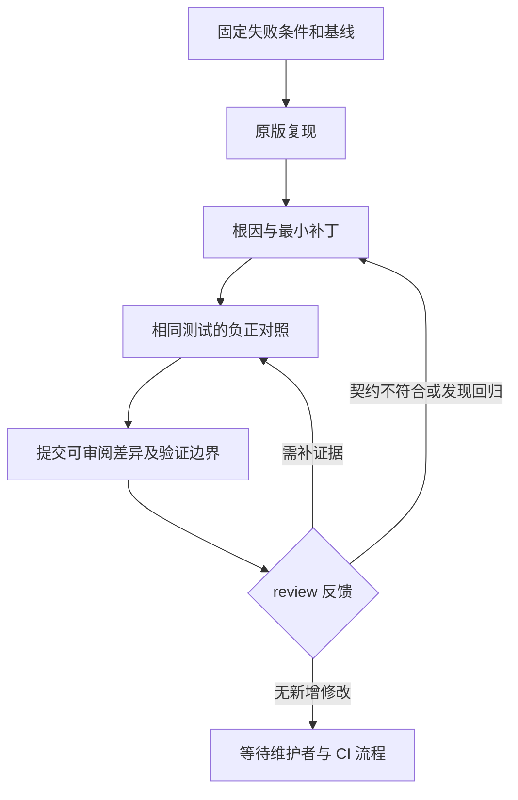

# 从故障到可审阅补丁：GitHub 修复流程

## 1. 以 FlashInfer 旧记录为参照

FlashInfer 案例最初表现为 RPC timeout，后续通过 TP、Graph、融合路径等控制变量，将范围缩到 fused kernel 的 polling。源码和 SASS 解释了 FTZ 如何影响 sentinel 判断，补丁前后 A/B 则证明了受测失败路径得到修复。

需要保留归属：位比较修复对应上游 PR，本地工作包括定位、回移、JIT 重建与回归，不能把整个上游修复归为个人原创。代表性触发位模式也不等于曾从原故障保存到具体 lane 的 payload。

近期 GitHub 修复沿用相同的证据组织方法：先说明哪个条件失败，再说明为什么失败，最后用同条件下的修复版测试说明改动的效果。

## 2. 固定问题与基线

先检查 issue 的触发条件、已有修复和 review 要求，确定本轮具体范围。固定源码版本，分别准备原版和修复版；新增测试可以同时放入两者，但要说明原版生产代码未改、测试文件已经扩展。

环境能导入不是验证成功。Triton 原生绑定必须匹配被测源码；FlashInfer 改 header 后还需要重建被实际加载的 JIT 产物；vLLM 复用 native artifacts 时要明确其版本限制。

## 3. 先证明失败发生在目标位置

| 案例 | 有效的失败证据 | 不能替代它的现象 |
|---|---|---|
| Triton | 目标转换触发特定断言或不支持错误 | 测试 masked load 自身构造错误 |
| Quack | warmup 改变默认 CUDA RNG，后续样本不匹配 | 依赖安装失败 |
| DeepSpeed | engine.step 的 skip 或参数状态违反目标精度契约 | 仅 hooks 通过 |
| CUTLASS | descriptor 参数提取在边界 extent 处溢出 | 只看到“大 shape 失败” |
| vLLM | 同 input IDs、匹配 mask 下的评分差异 | 不同 mask 的 HF 结果 |

先区分测试辅助脚本、依赖准备与生产代码的问题，避免把基础设施失败记成原 bug 复现。

## 4. 把补丁写成明确的契约

契约应说明哪些行为改变，哪些仍需成立。Quack 的目标是 warmup 不消耗应用 RNG；DeepSpeed 是仅在指定 BF16 opt-out 条件下放行，而不是关闭所有精度的保护；Mooncake 是回收取消槽位，但真实发送继续受 quota 控制。

对照用例覆盖正例、负例和相邻路径。除了“修复后通过”，还要确认原版在相同新测试下失败。源码机制解释与实测证据互相支持，不能相互替代。

## 5. Review 是实现的一部分

Triton 的隐式 FP16 中转数值正确，但不符合维护者的接口设计；后续转向清晰拒绝并重新测试。DeepSpeed 初版通过部分精度测试，却在 FP32 上产生回归；需要修补并补全矩阵，不能只引用初版绿色结果。

保持已有 PR 上下文，以新增提交记录返修。主线冲突解决时保留双方测试，不能通过整文件覆盖丢弃其他功能。若上游要求人工审阅或贡献声明，记录实际完成的步骤，不把自动测试等同于人工认可。

## 6. 分层写验证结果

| 层级 | 应记录什么 |
|---|---|
| 编译检查 | 目标架构、预期拒绝/成功；不称为硬件运行 |
| 单元测试 | 新增与既有测试范围、原版失败原因；mock 的部分单独标注 |
| 集成测试 | 实际设备、后端、数值参考和配置范围 |
| Smoke | 证明启动或执行完成；未做数值参考时明确标注 |
| CI | 本次 head 的实际检查；skipped、waiting、未授权不记为 passed |
| Review/merge | 批准、待复审、合入分别记；旧 diff 的批准不自动覆盖新改动 |

性能测试还需固定计时对象与统计方法。随机状态、数值错误或活性修复本身不自动构成性能提升。

## 7. 发布稿如何保留可复查性

每篇公开案例保留公开 PR、源码相对位置、触发条件、补丁思想、负正对照、实际覆盖范围与最后记录日期。内部日志路径、机器入口、账号和私有模型信息不进入稿件。

对未来复跑，按文中矩阵在固定公开源码版本上重建测试；不要把示意步骤当成已经随文交付的可执行脚本。原始实验未重跑时如实写“历史记录”，避免归档日期被误解为新验证日期。
